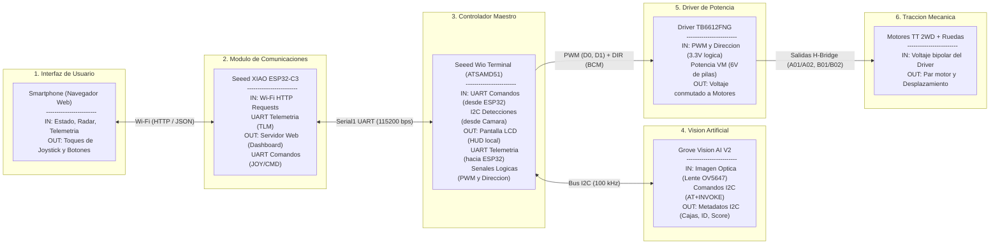

# Diagrama de Bloques Funcional del Sistema (Inputs & Outputs)

**Proyecto:** Auto Autónomo Guiado por Marcadores Visuales  
**Materia:** Embedded System Design (UPTP - 6to Semestre)  
**Hito:** Midterm  

---

## 1. Diagrama de Bloques Funcional

---

## 2. Matriz de Entradas y Salidas (I/O) por Módulo

| Módulo | Entradas (Inputs) | Salidas (Outputs) | Función en la Arquitectura |
| :--- | :--- | :--- | :--- |
| **Smartphone** | - Página web interactiva - Radar de visión - Telemetría en tiempo real | - Eventos táctiles del usuario (joystick virtual, botones de modo) | Interfaz hombre-máquina (HMI) inalámbrica. |
| **Seeed XIAO ESP32-C3** | - Peticiones HTTP del navegador - Tramas de telemetría UART (`TLM:...`) | - Página web (HTML5/CSS/JS) - Respuestas JSON (`/telemetry`) - Comandos UART (`JOY:x,y`, `CMD:AUTO`) | Coprocesador de comunicaciones inalámbricas (Wi-Fi AP a 2.4 GHz). |
| **Grove Vision AI V2** | - Luz ambiental / fotones (lente OV5647 CSI) - Comandos AT de inferencia por I2C (`AT+INVOKE`) | - Metadatos de inferencia por I2C (cajas delimitadoras `x, y, w, h`, `ID` de clase, confianza `score`) | Periférico inteligente de visión artificial embebida (acelerador NPU/DSP). |
| **Seeed Wio Terminal** | - Comandos seriales desde ESP32 (`Serial1`) - Paquetes de detección SSCMA por I2C (`Wire`) | - Renderizado gráfico en pantalla TFT LCD integrada - Telemetría periódica hacia ESP32 - Señales de control de motor: PWM (`D0, D1`) y dirección (`BCM4, BCM17, BCM5, BCM6`) | **Controlador maestro (Cerebro):** coordina la FSM, mezcla de tracción con trim y toma de decisiones. |
| **Driver TB6612FNG** | - Señales de control lógico (3.3V) desde el Wio - Potencia pura de 6V DC desde las 4 pilas AA (`VM`) | - Corriente y voltaje conmutados por modulación PWM y puente H | Etapa de amplificación y control de potencia motriz. |
| **Motores TT 2WD** | - Voltaje aplicado a las terminales | - Velocidad angular (RPM) y par de tracción en las ruedas | Actuadores físicos del robot móvil. |

---

## 3. Flujos de Control y Cierre de Lazos

### A. Lazo Abierto: Teleoperación Manual (Joystick)
1. El usuario desplaza el joystick táctil en la pantalla de su smartphone.
2. El navegador envía la posición normalizada mediante peticiones HTTP asíncronas (`/drive?x=...&y=...`) al ESP32-C3.
3. El ESP32-C3 traduce las peticiones y las transmite de inmediato por UART (`JOY:x,y\n`) al Wio Terminal.
4. El algoritmo de control del Wio Terminal calcula el mezclado diferencial de velocidad, aplica los factores de compensación (**Trim**) y modula los pines PWM y de dirección hacia el driver TB6612FNG.
5. Los motores responden instantáneamente con movimiento proporcional.

### B. Lazo Cerrado: Misión Autónoma (Guiado por Marcador)
1. El usuario pulsa `🚀 INICIAR AUTÓNOMO` desde el celular.
2. El Wio Terminal entra en el estado `ESTADO_AUTONOMO_AVANZANDO` y pone en marcha los motores hacia adelante a velocidad base controlada.
3. El Wio interroga periódicamente al módulo Grove Vision AI V2 mediante I2C (`AI.invoke`).
4. La cámara detecta la presencia del marcador en la escena y devuelve las coordenadas y tamaño de la caja delimitadora (`w` y `h`).
5. El algoritmo calcula la distancia estimada en tiempo real:
   $$d \approx \frac{f \cdot W}{w}$$
6. **Condición de Parada:** Cuando el ancho de la caja supera el umbral de proximidad ($w \ge 75 \text{ px}$ o $d \le 25 \text{ cm}$):
   - El Wio corta la señal PWM inmediatamente a 0 (frenado en seco).
   - Transiciona al estado `LLEGADA A MARCADOR!`.
   - Muestra el ID y confirmación en la pantalla LCD integrada.
   - Envía el estado `LLEGADA` por serial al ESP32 para que el celular lo muestre en rojo de misión cumplida.
