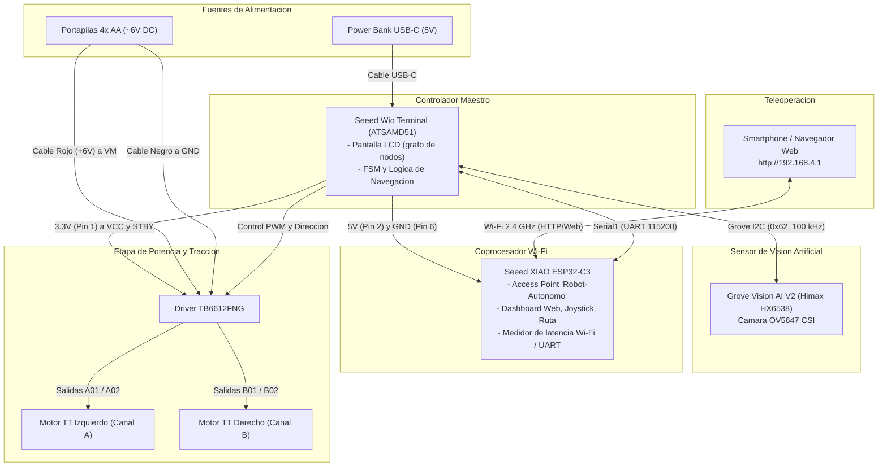
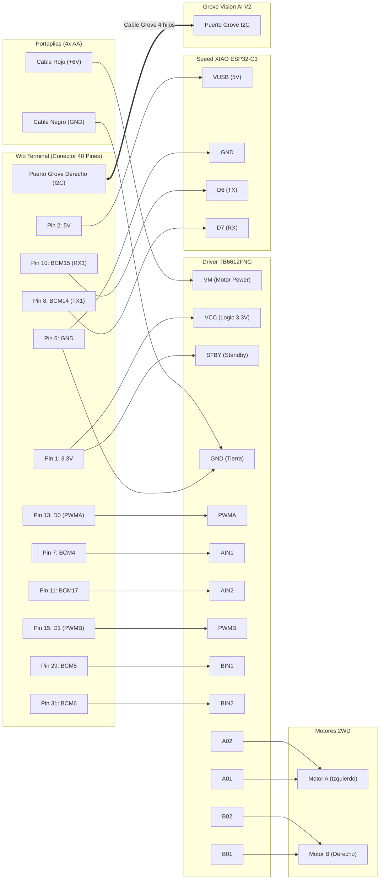

# Diagrama de Conexiones y Pinout del Sistema

Memoria técnica de cableado para el proyecto **Auto Autónomo Guiado por Marcadores Visuales** (Midterm - *Embedded System Design*).

---

## 1. Arquitectura General y Distribución de Potencia

El sistema utiliza una arquitectura de **alimentación separada con tierra común** para proteger los microcontroladores de los ruidos inductivos y caídas de tensión provocadas por los motores DC.

---

## 2. Diagrama Detallado de Conexiones Pin a Pin

---

## 3. Tablas de Pinout y Asignación de Señales

### Tabla A: Wio Terminal $\leftrightarrow$ Driver TB6612FNG

| Pin Físico Wio | Nombre en Código | Pin en Driver TB6612FNG | Función |
| :---: | :---: | :---: | :--- |
| **Pin 1** | `3.3V` | **VCC** | Alimentación lógica del chip |
| **Pin 1** | `3.3V` (puenteado a VCC) | **STBY** | Desactiva modo Standby (habilita puente H) |
| **Pin 6 / 14**| `GND` | **GND** | Tierra lógica común |
| **Pin 13** | `D0` | **PWMA** | Velocidad PWM Motor Izquierdo |
| **Pin 7** | `BCM4` | **AIN1** | Sentido Motor Izquierdo (HIGH = adelante) |
| **Pin 11** | `BCM17`| **AIN2** | Sentido Motor Izquierdo (LOW = adelante) |
| **Pin 15** | `D1` | **PWMB** | Velocidad PWM Motor Derecho |
| **Pin 29** | `BCM5` | **BIN1** | Sentido Motor Derecho (HIGH = adelante) |
| **Pin 31** | `BCM6` | **BIN2** | Sentido Motor Derecho (LOW = adelante) |

---

### Tabla B: Wio Terminal $\leftrightarrow$ Seeed XIAO ESP32-C3

| Pin Físico Wio | Nombre Señal Wio | Pin en XIAO ESP32-C3 | Función |
| :---: | :---: | :---: | :--- |
| **Pin 2 o Pin 4** | `5V` (VBUS USB) | **VUSB** | Alimentación del ESP32 desde el Wio |
| **Pin 6, 9 o 14** | `GND` | **GND** | Tierra común de referencia |
| **Pin 10** | `BCM15` (RX de `Serial1`) | **D6 (TX)** | Recibe órdenes del celular (`JOY:x,y`, `CMD:AUTO`), el salto calculado (`NODE:X`, `PATH:...`) y la posición (`SET:X`) |
| **Pin 8** | `BCM14` (TX de `Serial1`) | **D7 (RX)** | Envía telemetría de visión (`TLM:id,score,dist...`), posición y dirección (`POS:actual,siguiente,dir`) y pide el siguiente salto (`REQ:NEXT`) |

---

### Tabla C: Alimentación de Potencia de Motores

| Origen | Destino en Driver TB6612FNG | Notas de Seguridad |
| :--- | :--- | :--- |
| **Cable Rojo (+6V de 4x AA)** | **VM** | **NUNCA** conectar a los pines de 3.3V o 5V del microcontrolador. |
| **Cable Negro (GND de 4x AA)** | **GND** | Debe estar en el mismo bus de GND que el Wio Terminal. |
| **Salidas A01 y A02** | Motor TT Izquierdo | Si gira al revés, invertir los dos cables del motor. |
| **Salidas B01 y B02** | Motor TT Derecho | Si gira al revés, invertir los dos cables del motor. |

---

### Tabla D: Cámara Grove Vision AI V2

| Conector en Wio | Conector en Vision AI V2 | Señales | Protocolo |
| :--- | :--- | :--- | :--- |
| **Puerto Grove Derecho (I2C)** | Puerto Grove I2C | `SDA`, `SCL`, `3.3V`, `GND` | I2C en dirección `0x62` a 100 kHz |
